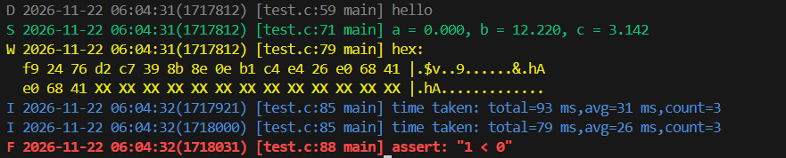

<div align="center">
  
  <h1>DebugSuite</h1>
  <span>一个轻量级且灵活的 C 项目调试和日志工具</span>
</div>
<br>
<div align="center">
  
  
</div>
<p align="center">
  <a href="../README.md">English</a> | <a href="">简体中文</a>
</p>

## 项目介绍
**DebugSuite** 是一个专为 C/C++ 项目设计的轻量级、模块化调试和日志工具。它提供了彩色日志输出、执行时间测量、值打印和断言检查等便捷的宏。DebugSuite 适用于嵌入式开发、应用调试和快速原型开发，可以轻松集成到任何 C 项目中。



## 功能特性
- 多种日志级别：debug、info、success、warning、error、fatal
- 彩色格式化控制台输出，便于日志区分
- 编译期与运行期日志级别过滤
- 执行时间测量宏，用于性能分析
- 方便的变量和表达式值打印，支持分级变体
- 十六进制转储输出（每行 16 字节，hex + ASCII 两列）
- 灵活的断言宏，提供详细的错误报告
- 最小化依赖，易于移植和扩展

## 目录结构
- `DebugSuite/`: DebugSuite 核心实现 (`debug_suite.c`、`debug_suite.h`)
- `Test/`: DebugSuite 的示例和测试代码

## 快速开始
### 1. 克隆仓库
```bash
git clone https://github.com/Rev-RoastedDuck/DebugSuite.git
cd DebugSuite
```

### 2. 构建和测试
CMake 构建测试项目：
```bash
cd Test
cmake -S . -B build
cmake --build build
./start
```

### 3. 集成到你的项目
**1) CMake 集成**  
```cmake
add_subdirectory(path/to/DebugSuite debuguite)
target_link_libraries(your_target PRIVATE debugsuite)
```
**2) 手动集成**  
将 `DebugSuite/` 目录下的 `debug_suite.h` 和 `debug_suite.c` 拷贝到项目中，并在工程中配置包含路径与编译选项

**3) 使用示例**  
```c
#include "debug_suite.h"

int main(void) {
    int a = 42;
    float b = 3.14f;
    uint8_t buf[] = {0x01, 0x02, 0x03, 0x04};

    DEBUG_PRINT_INFO(1, "应用程序已启动。a=%d, b=%.2f", a, b);
    DEBUG_PRINT_VALUES(1, a, b);
    DEBUG_PRINT_HEX(1, buf, sizeof(buf));

    DEBUG_TIME_TAKEN_START(1, 3);
    // ... 你的代码 ...
    DEBUG_TIME_TAKEN_END;

    DEBUG_ASSERT(DEBUG_ENABLE, a > 0);
    return 0;
}
```

## 文档
查看 [`DebugSuite/debug_suite.h`](../DebugSuite/debug_suite.h) 中的注释以获取 API 使用和宏描述。

## 许可证
本项目 **DebugSuite** 采用 Apache License 2.0 许可证发布。详情请参考 [**LICENSE**](../LICENSE)
