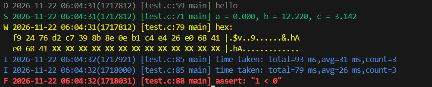

<div align="center">
  
  <h1>DebugSuite</h1>
  <span>A lightweight and flexible debugging and logging utility for C projects</span>
</div>
<br>
<div align="center">
  
  
</div>
<p align="center">
  <a href="">English</a> | <a href="./Docs/README_cn.md">简体中文</a>
</p>

## Project Introduction
**DebugSuite** is a lightweight, modular debugging and logging utility designed for C/C++ projects. It provides convenient macros for colored log output, execution time measurement, value printing, and assertion checks. DebugSuite is suitable for embedded development, application debugging, and rapid prototyping, and can be easily integrated into any C project.



## Features
- Multiple log levels: debug, info, success, warning, error, fatal
- Colorful and formatted console output for easy log distinction
- Compile-time and runtime log-level filtering
- Execution time measurement macros for performance profiling
- Convenient value printing with per-level variants
- Hex dump output for binary data (16 bytes per line, hex + ASCII)
- Flexible assertion macros with detailed error reporting
- Minimal dependencies, easy to port and extend


## Directory Structure
- `DebugSuite/`: Core implementation of DebugSuite (`debug_suite.c`, `debug_suite.h`)
- `Test/`: Example and test code for DebugSuite

## Quick Start
### 1. Clone the repository
```bash
git clone https://github.com/Rev-RoastedDuck/DebugSuite.git
cd DebugSuite
```

### 2. Build and test
Build the test project with CMake:
```bash
cd Test
cmake -S . -B build
cmake --build build
./start
```

### 3. Integrate into your project
**1) CMake integration**  
```cmake
add_subdirectory(path/to/DebugSuite debugsuite)
target_link_libraries(your_target PRIVATE debugsuite)
```
**2) Manual integration**  
Copy `debug_suite.h` and `debug_suite.c` from `DebugSuite/` into your project, and configure the include path and compile options in your build system.

**3) Example usage**  

```c
#include "debug_suite.h"

int main(void) {
    int a = 42;
    float b = 3.14f;
    uint8_t buf[] = {0x01, 0x02, 0x03, 0x04};

    DEBUG_PRINT_INFO(1, "Application started. a=%d, b=%.2f", a, b);
    DEBUG_PRINT_VALUES(1, a, b);
    DEBUG_PRINT_HEX(1, buf, sizeof(buf));

    DEBUG_TIME_TAKEN_START(1, 3);
    // ... your code ...
    DEBUG_TIME_TAKEN_END;

    DEBUG_ASSERT(DEBUG_ENABLE, a > 0);
    return 0;
}
```

## Documentation
See the comments in [`DebugSuite/debug_suite.h`](DebugSuite/debug_suite.h) for API usage and macro descriptions.

## License
This project **DebugSuite** is released under the Apache License 2.0. For details, please refer to [**LICENSE**](LICENSE)